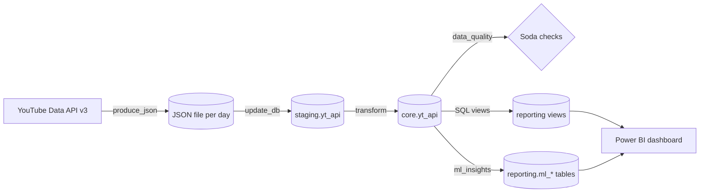
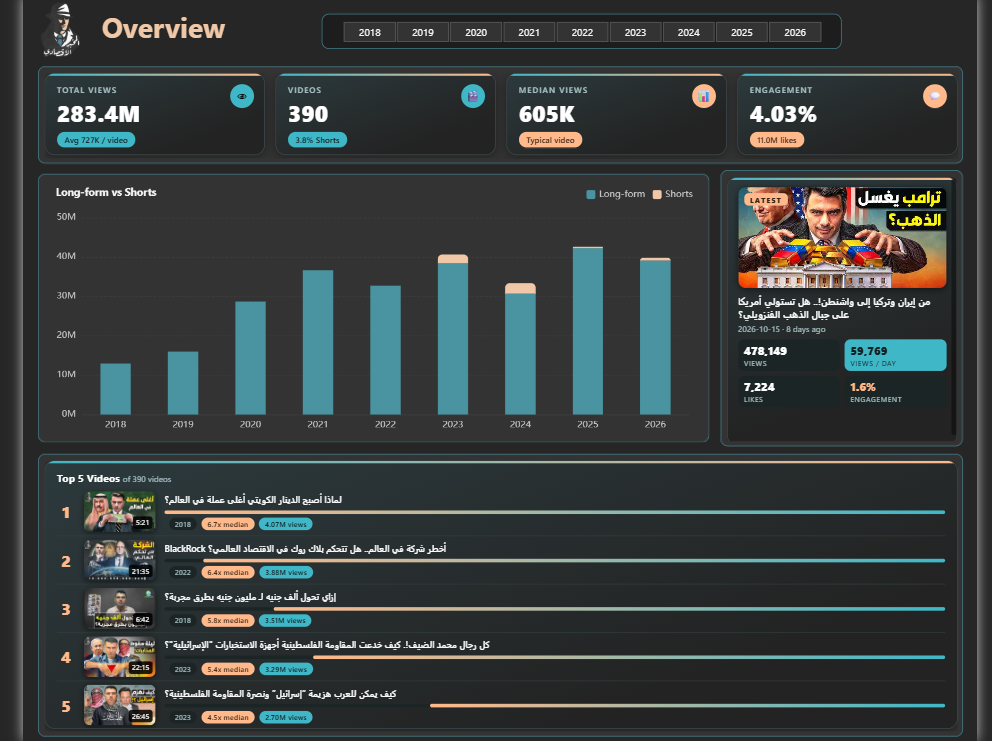
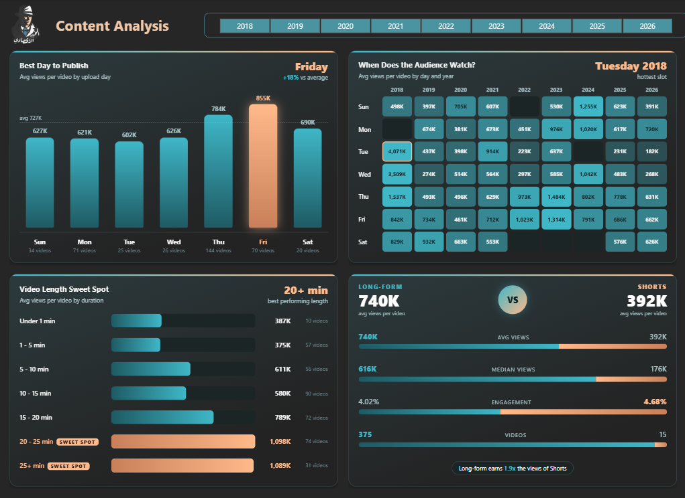
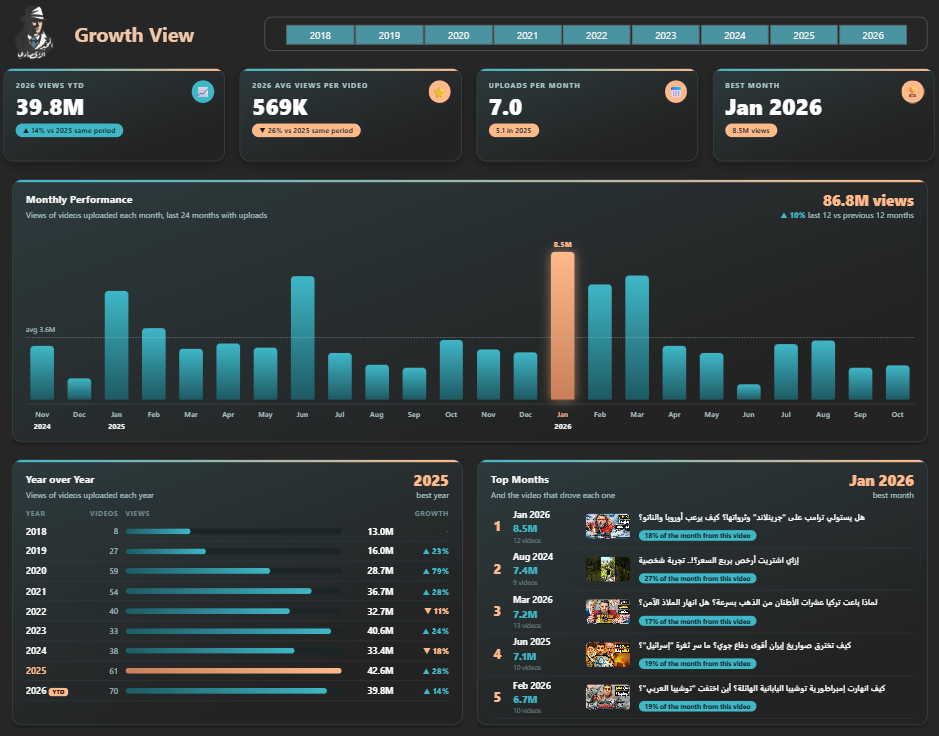
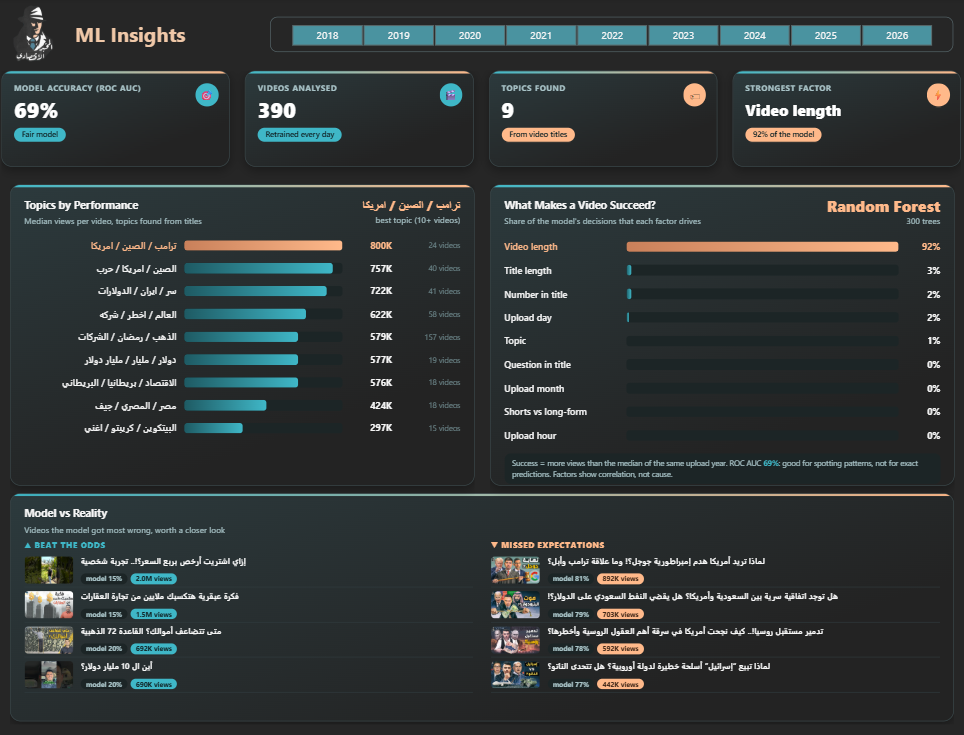

# YouTube ELT Pipeline

An end-to-end data pipeline that collects every video of the Arabic economics channel
[**@MokhbirEqtisadi**](https://www.youtube.com/@MokhbirEqtisadi) from the YouTube Data API,
loads it into a PostgreSQL warehouse, checks its quality, runs machine learning on it and
serves the results in a Power BI dashboard. Everything runs on a daily schedule with
Apache Airflow inside Docker, and every push is tested and deployed with GitHub Actions.


---

## Table of contents

- [Architecture](#architecture)
- [Airflow DAGs](#airflow-dags)
- [Data model](#data-model)
- [Data quality](#data-quality)
- [Machine learning insights](#machine-learning-insights)
- [Power BI dashboard](#power-bi-dashboard)
- [Key findings](#key-findings)
- [Testing and CI/CD](#testing-and-cicd)
- [Project structure](#project-structure)
- [Getting started](#getting-started)
- [Challenges solved](#challenges-solved)
- [Acknowledgements](#acknowledgements)

---

## Architecture



| Layer | Tool |
|---|---|
| Extract | Python + `requests` on the YouTube Data API v3 |
| Orchestration | Apache Airflow 2.9.2 with the CeleryExecutor (Redis broker) |
| Storage | PostgreSQL 13 with `staging`, `core` and `reporting` schemas |
| Data quality | Soda Core |
| Machine learning | scikit-learn (TF-IDF, KMeans, Random Forest) |
| Containers | Docker Compose with a custom Airflow image on Docker Hub |
| CI/CD | GitHub Actions |
| BI | Power BI Desktop with HTML Content and Apache ECharts visuals |

---

## Airflow DAGs

Four DAGs run every day, one hour apart (Africa/Cairo time):

| DAG | Schedule | What it does |
|---|---|---|
| `produce_json` | 14:00 | Finds the channel's uploads playlist, pages through every video ID and saves the video statistics as `data/<date>.json` |
| `update_db` | 15:00 | Upserts the JSON into `staging.yt_api`, then transforms it into `core.yt_api` (inserts new videos, updates changed ones, deletes removed ones) |
| `data_quality` | 16:00 | Runs Soda checks on the staging and core layers |
| `ml_insights` | 17:00 | Builds topics, trains the success model and finds similar videos, then writes the results to `reporting.ml_*` |

---

## Data model

**`staging.yt_api`**: raw data as it comes from the API.

**`core.yt_api`**: cleaned data. The ISO 8601 duration (`PT21M35S`) becomes a `TIME`, and a
new `Video_Type` column marks videos of 60 seconds or less as `Shorts`.

| Column | Type |
|---|---|
| `Video_ID` | `VARCHAR(11)`, primary key |
| `Video_Title` | `TEXT` |
| `Upload_Date` | `TIMESTAMP` |
| `Duration` | `TIME` |
| `Video_Type` | `VARCHAR(10)` |
| `Video_Views` / `Likes_Count` / `Comments_Count` | `INT` |

**`reporting`** schema, read by Power BI:

| Object | Description |
|---|---|
| `video_stats` (view) | One row per video with year, month, weekday, duration in minutes, engagement rate and video URL |
| `monthly_summary` (view) | Videos, views, likes and comments per month |
| `type_summary` (view) | Shorts vs long-form comparison |
| `ml_topics` | Topics found from the titles and how they perform |
| `ml_video_topics` | Topic of every video |
| `ml_video_predictions` | Out-of-fold success probability per video |
| `ml_feature_importance` | How much each factor drives the success model |
| `ml_model_metrics` | ROC AUC, number of videos and success rate |
| `ml_similar_videos` | The 5 most similar videos for every video |

The views are defined in [`sql/powerbi_views.sql`](sql/powerbi_views.sql).

---

## Data quality

Soda Core runs these checks on both `staging` and `core`:

- `Video_ID` has no missing values and no duplicates
- no video has more likes than views
- no video has more comments than views

If a check fails, the DAG fails and the problem shows up in Airflow before it reaches the dashboard.

---

## Machine learning insights

The `ml_insights` DAG retrains everything every day on the latest data.

**1. Topic discovery.** Titles are normalized for Arabic (diacritics removed, letter variants
like `أ إ آ` unified), common Arabic and English words are removed, and the titles are turned
into TF-IDF vectors. KMeans then groups them, and the number of topics is picked automatically
with the silhouette score.

**2. What makes a video succeed.** A video counts as a success when it gets more views than
the median of its own upload year, so older videos don't win just because they had more time.
A Random Forest (300 trees) learns from video length, upload day, hour and month, title length,
question marks and numbers in the title, and the topic.

- Accuracy is measured with 5-fold cross validation: **ROC AUC 0.69**. The model is clearly
  better than a coin flip (0.50), but not strong enough to predict a single video.
- Factor importance uses **permutation importance on held-out videos**. The default Random
  Forest importance was tested first and overrated columns with many unique values (for
  example, title length got 16% and turned out to be close to 0%).

**3. Similar videos.** Titles are compared with character n-grams (3 to 5 characters) and
cosine similarity. Character n-grams work better than words for Arabic because the same word
appears with different prefixes and suffixes.

> The model shows **correlation, not cause**. Longer videos perform better on this channel,
> but that doesn't prove that making a video longer will bring more views.

---

## Power BI dashboard

The dashboard has four pages, all built with the channel's colors. The cards and lists are
DAX measures that return HTML (HTML Content visual), and the main chart uses the Apache
ECharts visual. Every page reacts to the year slicer.

### Overview

<!-- Replace with your screenshot -->


Total views, videos, median views and engagement, long-form vs Shorts views per year,
the latest video and the top 5 videos of all time.

### Content Analysis

<!-- Replace with your screenshot -->


Best day to publish, the video length sweet spot, a weekday x year heatmap and a
long-form vs Shorts face-off.

### Growth

<!-- Replace with your screenshot -->


Year-to-date growth against the same period of the previous year, monthly performance for
the last 24 months, year-over-year table and the top months with the video that drove each one.

### ML Insights

<!-- Replace with your screenshot -->


Model accuracy, topics ranked by median views, factor importance and the videos the model
got most wrong.

---

## Key findings

Based on 390 videos and 283.4M views:

- **Video length is the strongest signal.** Videos of 20+ minutes reach about **1.09M** median
  views, almost double the 5 to 10 minute videos (611K).
- **Long-form beats Shorts.** Long-form videos get **1.9x** the average views of Shorts,
  although Shorts have a slightly higher engagement rate (4.68% vs 4.02%).
- **Geopolitics performs best.** Topics about the US, China and Trump lead with about **800K**
  median views, while crypto and Bitcoin videos are at the bottom with about **297K**.
- **Friday is the best day to publish**, with **18%** more views than the average day.
- **More videos, fewer views each.** In 2026 the channel publishes 7 videos per month instead
  of 5.1. Total views are up **14%** against the same period of 2025, but average views per
  video are down **26%**.

---

## Testing and CI/CD

| Test type | What it covers |
|---|---|
| Unit tests | Airflow variables and connections, DAG integrity (4 DAGs and their task counts), and the ML functions (`tests/ml_test.py`) |
| Integration tests | Real connection to the YouTube API and to PostgreSQL |
| End-to-end tests | Every DAG runs with `airflow dags test`, in order |

The GitHub Actions workflow [`.github/workflows/ci-cd-youtube-elt.yaml`](.github/workflows/ci-cd-youtube-elt.yaml)
has two jobs:

1. **Build and push Docker image.** Runs only when the `Dockerfile` or `requirements.txt`
   changes, and pushes the image to Docker Hub with the `latest` and commit SHA tags.
2. **Unit, integration and E2E tests.** Starts the whole stack with Docker Compose and runs
   all the tests and all four DAGs. It runs only when the DAGs, `include/` or
   `docker-compose.yaml` change.

Both jobs can also be started by hand with `workflow_dispatch`. Secrets and variables are
stored in GitHub, not in the code.

---

## Project structure

```
youtube-etl-pipeline/
├── .github/workflows/
│   └── ci-cd-youtube-elt.yaml    # CI/CD pipeline
├── dags/
│   ├── Main.py                   # The 4 DAG definitions
│   ├── api/
│   │   └── video_stats.py        # YouTube API extraction
│   ├── datawarehouse/            # Staging and core load, transform, upsert
│   ├── dataquality/
│   │   └── soda.py               # Soda checks task
│   └── ml/
│       ├── features.py           # Topics, success model, similar videos
│       └── insights.py           # Airflow tasks that write reporting.ml_*
├── include/soda/                 # Soda configuration and checks
├── sql/
│   └── powerbi_views.sql         # Reporting views for Power BI
├── tests/                        # Unit, integration and ML tests
├── Assets/                       # Dashboard screenshots
├── docker-compose.yaml
├── dockerfile                    # Custom Airflow image
├── requirements.txt
└── PBI_Dashboard.pbix            # Power BI dashboard
```

---

## Getting started

### Prerequisites

- Docker Desktop
- A YouTube Data API v3 key from the [Google Cloud Console](https://console.cloud.google.com/)
- Power BI Desktop (for the dashboard)

### 1. Configure the environment

Create a `.env` file in the project root. It is ignored by git, never commit it.

```env
# Docker image
DOCKERHUB_NAMESPACE=
DOCKERHUB_REPOSITORY=
IMAGE_TAG=latest
AIRFLOW_UID=50000

# Airflow UI user
AIRFLOW_WWW_USER_USERNAME=
AIRFLOW_WWW_USER_PASSWORD=
FERNET_KEY=

# YouTube API
API_KEY=
CHANNEL_HANDLE=MokhbirEqtisadi

# Postgres server
POSTGRES_CONN_HOST=postgres
POSTGRES_CONN_PORT=5432
POSTGRES_CONN_USERNAME=
POSTGRES_CONN_PASSWORD=

# Airflow metadata, Celery results and ELT databases
METADATA_DATABASE_NAME=
METADATA_DATABASE_USERNAME=
METADATA_DATABASE_PASSWORD=
CELERY_BACKEND_NAME=
CELERY_BACKEND_USERNAME=
CELERY_BACKEND_PASSWORD=
ELT_DATABASE_NAME=elt_db
ELT_DATABASE_USERNAME=
ELT_DATABASE_PASSWORD=
```

### 2. Start the stack

```bash
docker compose up -d
```

To build the image locally instead of pulling it from Docker Hub:

```bash
docker build -t <namespace>/<repository>:latest .
docker compose up -d --force-recreate
```

### 3. Run the pipeline

Open Airflow at [http://localhost:8081](http://localhost:8081), unpause the DAGs and trigger
them in order: `produce_json`, `update_db`, `data_quality`, `ml_insights`.

### 4. Create the reporting views

```bash
docker exec -i postgres psql -U <elt_user> -d elt_db < sql/powerbi_views.sql
```

### 5. Open the dashboard

Open `PBI_Dashboard.pbix` and point the PostgreSQL source to `127.0.0.1:5432`, database `elt_db`.

---

## Challenges solved

- **Slow DAG parsing on a laptop.** Importing pandas and scikit-learn at the top of the ML
  module made the scheduler hit Airflow's 30 second DAG import timeout, and all DAGs
  disappeared. The heavy imports were moved inside the tasks, and the import timeout was
  raised for slower machines.
- **Arabic text.** Titles needed normalization (diacritics, letter variants) and an
  Arabic + Egyptian stopword list. The channel's own name had to be removed too, because it
  appeared in many titles and formed a fake topic.
- **Misleading feature importance.** The built-in Random Forest importance overrated
  columns with many unique values. Switching to permutation importance on held-out data
  gave honest numbers.
- **Fair success label.** Comparing every video with the median of its own upload year
  stops older videos from looking better just because they had more time to collect views.

---

## Acknowledgements

The pipeline, Docker setup, testing and CI/CD follow the Udemy course
**Data Engineering Project: SQL, Python, Airflow, Docker, CI/CD**
The Power BI dashboard and the machine learning DAG are my own extensions of the project.
